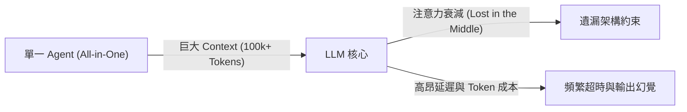
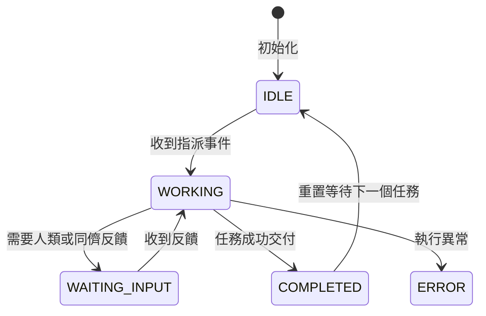

# 第 1 章 多 Agent 協同新範式：從單一 Chatbot 到自主工程團隊

> 「當一個系統的複雜度超過單一認知實體的承受上限時，模組化與分工不是一種可選的優化，而是唯一的生存之道。」

---

## 1.1 單一 Agent 的黃金極限與崩塌點

在生成式 AI 與大語言模型（LLM）剛進入軟體工程領域時，主流做法通常是建立一個全知全能的「對話機器人（Chatbot）」或單一 Copilot：我們給予模型整個專案的程式碼上下文，期望它能同時讀懂架構、寫出程式碼、修復漏洞並通過所有安全檢查。

然而，當專案規模從單一腳本擴展到具備數十個模組的實際生產系統時，這種「單兵作戰」模式會迅速撞上一道不可逾越的物理之牆。

可以把它想像成把一本技術書交給同一個人從頭做到尾：他要同時當作者、工程師、審稿、排版、封面設計與發行。短篇文章或許可以，但一本技術書很快會失控。多 Agent 的核心不是讓更多 AI 同時說話，而是把角色、責任與驗收方式分清楚。

| 單一 Agent | 多 Agent 團隊 |
|---|---|
| 一個模型處理所有任務 | 多個角色分工合作 |
| 上下文巨大，容易遺漏限制 | 每個 Agent 只取得必要上下文 |
| 自我審查容易產生確認偏誤 | 獨立審查角色負責質疑與驗證 |
| 出錯時難以定位責任 | 可回到特定角色、階段與交付物 |
| 完成訊號常依賴自然語言 | 以測試、審稿、build 作為品質閘門 |

### 1.1.1 上下文視窗的真實成本與注意力衰減（Lost in the Middle）

現代 LLM 雖然宣稱具備 128K 甚至超過 1M Token 的上下文視窗，但在軟體工程實踐中，「上下文容量」並不等同於「有效注意力」。

史丹佛大學與柏克萊大學的多項研究（包括著名的 *Lost in the Middle* 現象）表明：當上下文長度急遽膨脹時，模型對於位於提示詞中間區域的指令與細節約束，召回準確率（Retrieval Accuracy）會呈現顯著的 U 型衰減。在軟體開發場景中，這意味著：
1. **指令覆蓋（Prompt Drift）**：當你向單一 Agent 輸入了 5 萬字的系統規格、API 文件以及 20 個檔案的原始程式碼時，它會開始忽略邊界條件（例如「請保持向下相容」或「使用無狀態認證」）。
2. **Token 成本與延遲二次方增長**：自注意力機制（Self-Attention）的時間與計算複雜度本質上隨著 Token 數量劇增。每次即使只修改一行程式碼，都需要將數萬 Token 重新餵入模型，造成昂貴的 API 帳單與數十秒的響應等待。



### 1.1.2 角色衝突難題（The Persona Paradox）

除了計算維度的瓶頸，單一 Agent 還有一個更嚴重的認知維度缺陷——**角色動機衝突**。

在傳統軟體工程中，為什麼「開發人員（Developer）」與「品質保證工程師（QA/Tester）」通常由不同人擔任？因為這兩種角色具有相互對立的心智模型：
* **開發者的動機**：最小阻力實作功能、證明程式碼能跑、樂觀傾向。
* **QA 與審查員的動機**：邊界極限測試、挑出邏輯瑕疵、悲觀質疑傾向。

如果你要求同一個 LLM：「請為這個系統編寫程式碼，並同時找出你自己程式碼中的潛在弱點」，模型會傾向於給出確認偏誤（Confirmation Bias）——它會認為自己的推導已經很完美，從而給出浮於表面的審查報告。

**解決之道，就是多 Agent 分工（Multi-Agent Architecture）：** 讓專門的 Agent 只承擔單一職責、持有最小化上下文，並透過明確的通訊合約互相協作與制衡。

---

## 1.2 多 Agent 協同的架構模式

將單一巨石型 Agent 拆解為團隊後，核心挑戰轉移到了「通訊與組織拓撲」。目前業界最主流的三種模式如下：

### 1.2.1 集中式編排（Orchestrator-Worker Pattern）
由一個核心的 Orchestrator（指揮官）Agent 接管使用者的原始需求，將其拆解為子任務（Sub-tasks），並指派給下游的專業 Worker（如程式碼編寫者、測試者）。Worker 完成後向 Orchestrator 回報，由其統整結果。

* **優點**：流程高度可控、狀態集中管理。
* **缺點**：Orchestrator 容易成為單點吞吐瓶頸；若 Orchestrator 規劃錯誤，整條鏈路將偏離方向。

### 1.2.2 流水線式傳遞（Linear Pipeline Pattern）
如同傳統 Unix 管道（Pipeline）：`Agent A | Agent B | Agent C`。
前一個 Agent 的輸出直接作為下一個 Agent 的輸入。例如：`架構師 (生成 PRD) ➔ 工程師 (生成程式碼) ➔ 審查員 (審批發布)`。

* **優點**：邊界極度清晰、單向無分支，極易做自動化 CI/CD 整合。
* **缺點**：回溯重試（Backtracking）成本較高，若中途某一步驟失敗，需要設計明確的退回機制。

### 1.2.3 去中心化訊息總線（Event-Driven Message Bus）
所有 Agent 掛載在一個非同步訊息總線（Message Bus）上，透過「主題訂閱（Pub/Sub）」進行通訊。Agent 根據事件主題（例如 `task.review.failed`）自主響應並推動流程。

* **優點**：系統解耦最徹底，可隨意插入新的監聽代理（例如日誌審查 Agent、資安掃描 Agent）而不破壞現有程式碼。
* **缺點**：需設計嚴格的事件合約與循環偵測機制，避免 Agent 間產生非預期的對話死迴圈。

---

## 1.3 核心合約設計：Agent 如何精確通訊

在多 Agent 系統中，絕對不能依賴混亂的純文字非結構化交談，必須建立標準化的**訊息信封（Message Envelope）**與**狀態機（State Machine）**。

### 1.3.1 結構化事件契約（Message Envelope）

每個在系統中流轉的事件包，至少應包含發送者、接收者、主題類型以及酬載：

```python title="examples/ch01_multi_agent_baseline/agent_bus.py"
@dataclass
class MessageEnvelope:
    """結構化訊息信封 (Message Envelope Contract)"""
    topic: str
    sender: str
    recipient: str
    payload: Dict[str, Any]
    message_id: str = field(default_factory=lambda: str(uuid.uuid4())[:8])
    timestamp: str = field(default_factory=lambda: datetime.now(timezone.utc).isoformat())
    reply_to: Optional[str] = None
```

### 1.3.2 狀態轉換生命週期

每個參與協同的 Agent，必須具備可被觀測的狀態：



---

## 1.4 實戰項目：50 行程式碼打造第一個多 Agent 協同最小原型

現在，我們不藉助任何沉重且快速迭代破壞相容性的外部大模型框架，純粹使用 Python 標準庫（`asyncio`, `dataclasses`）來實現一個最簡可運行的多 Agent 系統。

### 1.4.1 核心架構解析

本實戰範例包含三位核心成員：
1. **`PlannerAgent`（規劃者）**：分析輸入並產出分解步驟。
2. **`CoderAgent`（工程師）**：訂閱 `task.plan` 主題，生成具體可執行的程式碼。
3. **`ReviewerAgent`（審查員）**：訂閱 `task.code` 主題，以獨立視角檢查並給出審核決策。

### 1.4.2 訊息總線實作

```python title="examples/ch01_multi_agent_baseline/agent_bus.py"
class MessageBus:
    """異步訊息路由中樞 (Asynchronous In-Memory Message Bus)"""

    def __init__(self, max_history: int = 1000):
        self._subscribers: Dict[str, List[Callable[[MessageEnvelope], Coroutine[Any, Any, None]]]] = {}
        self._history: List[MessageEnvelope] = []
        self._max_history = max_history
        self._lock = asyncio.Lock()

    def subscribe(self, topic: str, handler: Callable[[MessageEnvelope], Coroutine[Any, Any, None]]) -> None:
        if topic not in self._subscribers:
            self._subscribers[topic] = []
        self._subscribers[topic].append(handler)

    async def publish(self, envelope: MessageEnvelope) -> None:
        async with self._lock:
            self._history.append(envelope)
            if len(self._history) > self._max_history:
                self._history.pop(0)

        handlers = list(self._subscribers.get(envelope.topic, []))
        if envelope.topic != "*":
            handlers.extend(self._subscribers.get("*", []))

        if handlers:
            await asyncio.gather(*(h(envelope) for h in handlers), return_exceptions=True)
```

### 1.4.3 協同執行與輸出觀察

在 `main.py` 中，我們將總線與各個 Agent 串聯起來：

```python title="examples/ch01_multi_agent_baseline/main.py"
async def main() -> None:
    bus = MessageBus()
    planner = PlannerAgent("planner", bus)
    coder = CoderAgent("coder", bus)
    reviewer = ReviewerAgent("reviewer", bus, max_turns=3)

    bus.subscribe("task.plan", coder.handle_message)
    bus.subscribe("task.code", reviewer.handle_message)

    user_prompt = "請實作一個計算兩倍數值的函數，並完成審查"
    plan = await planner.step(user_prompt)
    code_res = await coder.step()
    review_res = await reviewer.step()
```

當我們在終端執行時，可以清晰觀察到各 Agent 的狀態流轉：
```text
============================================================
🚀 啟動多 Agent 協同最小原型系統 (Chapter 1)
============================================================

[使用者輸入] 請實作一個計算兩倍數值的函數，並完成審查

▶ 階段 1: Planner 開始任務規劃...
  [Planner 產出步驟] ['實作驗證模組', '加上型別註記', '編寫單元測試']

▶ 階段 2: Coder 接收規劃並生成程式碼...
  [Coder 程式碼片段]
def solve(x: int) -> int:
    return x * 2

▶ 階段 3: Reviewer 執行審查...
  [Reviewer 決策] APPROVED - 型別註記完整，邏輯通過審查。

============================================================
✅ 協同流水線成功完成！
總線記錄事件數: 3
============================================================
```

---

## 1.5 生產環境實務陷阱：死迴圈與熔斷機制（Circuit Breaker）

在多 Agent 自主協同系統中，最致命的故障模式之一是「**話癆陷阱（Ping-Pong Deadlock）**」：
* Coder 產出程式碼 ➔ Reviewer 提出小瑕疵 ➔ Coder 修正 ➔ Reviewer 又提出新視角 ➔ 雙方進入無窮遞迴對話。

這不僅會耗盡伺服器計算資源，更會在幾分鐘內刷爆 API 額度。因此，**所有生產級 Agent 都必須內建熔斷器（Circuit Breaker）**：

```python title="examples/ch01_multi_agent_baseline/agents.py"
# 熔斷保護機制：若超過最大輪數強制終止或降級處理
if self.turn_count > self.max_turns:
    result = {
        "task_id": payload["task_id"],
        "decision": "APPROVED_BY_CIRCUIT_BREAKER",
        "notes": f"達到最大審查輪數 ({self.max_turns})，強制熔斷完成。"
    }
```

---

## 1.6 從一句需求到多 Agent 任務拆解

為了讓抽象架構更具體，讓我們用本書專案本身作為例子。假設使用者只提出一句需求：「用多 Agent 團隊寫一本介紹多 Agent 實作的科技書」。如果交給單一 Chatbot，它可能會直接生成一份長文章，內容看起來完整，但很難保證程式碼可執行、章節一致、排版可建置，也不容易在後續迭代中維護。

多 Agent 團隊會把這句需求拆成一連串明確任務。首先，Orchestrator 將需求轉成 PRD，決定書名、讀者、章節數、產物格式與完成標準。接著，Hermes 根據 PRD 撰寫章節規格，確保全書邏輯與術語一致。Codex 根據每章規格建立可測試範例，並以 pytest 證明範例能跑。OpenCode 依據規格與範例撰寫正文。Pi 進行標點、Markdown、Typst 與小型樣式修補。最後，Antigravity 或出版 pipeline 執行 build，產出 PDF 與 release artifacts。

這種拆解的重點不是增加複雜度，而是讓每個成果都有明確責任人與驗收方式。PRD 是否完整，可以由章節規格覆蓋率檢查；範例是否可靠，可以由測試檢查；正文是否可信，可以由 Hermes 審稿；排版是否成功，可以由 Typst build 檢查。當每一層都有可觀測結果時，使用者不必盲目信任某個巨型回答，而能逐步確認成果。

## 1.7 多 Agent 系統的四個基礎元件

不論使用哪一種工具，多 Agent 系統都離不開四個基礎元件：角色、權限、交付物與品質閘門。

**角色** 定義代理為何存在。沒有角色的代理會互相重疊，最後每個人都想做所有事。角色應該具體，例如「章節主筆」、「程式驗證者」、「技術審稿者」、「排版修補者」，而不是籠統地稱為「AI 助手」。

**權限** 定義代理能碰什麼。Codex 可以修改 examples，OpenCode 可以修改 src，Hermes 維護 docs 與 qa，Pi 做精準 patch，Antigravity 管編排與發布。權限不只是安全設定，也是協作禮貌。清楚權限能避免代理互相覆蓋工作。

**交付物** 定義代理完成後留下什麼。好的交付物不是一句「完成了」，而是檔案、測試結果、審稿報告、build log、manifest 或摘要。交付物讓下一個代理可以接手，也讓人類可以審查。

**品質閘門** 定義何時可以進入下一階段。測試未通過，不應開始撰寫引用該程式的教學；審稿有重大錯誤，不應進入排版；PDF build 失敗，不應發布。品質閘門讓多 Agent 團隊不會只追求速度，而能保持可信交付。

## 1.8 常見反模式：讓所有 Agent 都能改所有檔案

多 Agent 專案最危險的反模式，是把每個代理都設成全能管理員。短期看起來方便，因為任何代理都能立即修任何問題；長期則會造成混亂，因為沒有人知道某個檔案為什麼被改、誰應該負責、哪個版本才是權威。

另一個反模式是缺少交接摘要。代理 A 做完工作後只留下大量終端輸出，代理 B 必須從頭閱讀所有歷史才能接手。這會讓多 Agent 協作退化成昂貴的上下文搬運。正確做法是每次交接都留下簡短但結構化的摘要：已完成什麼、修改哪些檔案、驗證結果如何、還有哪些風險。

第三個反模式是用自然語言取代狀態機。人類可以理解「差不多好了」，但自動化 pipeline 不能。系統需要明確狀態，例如 `RUNNING`、`BLOCKED`、`DONE`、`FAILED`，也需要明確測試結果，例如 PASS 或 FAIL。

第四個反模式是沒有熔斷。當兩個代理互相要求修正，或某個測試反覆失敗時，系統必須知道何時停止。停止不是失敗，而是保護資源與品質的必要機制。

## 1.9 你現在應該能做到

讀完本章後，你應該能：

- 說明單一 Agent 在長程任務中的上下文與角色衝突限制。
- 區分 Orchestrator、Pipeline 與 Message Bus 三種協作模式。
- 說明 Message Envelope 與狀態機為何是多 Agent 通訊基礎。
- 執行第 1 章範例，觀察 Planner、Coder、Reviewer 的協作流程。

## 1.10 本章小結

本章我們跳脫了傳統單一 Chatbot 的單兵思維，剖析了多 Agent 系統在認知分離與上下文精簡上的必然性。我們定義了結構化事件合約（Message Envelope），並透過 Python 標準庫完成了零依賴的 Message Bus。

在接下來的第 2 章中，我們將走出單一 Python 進程的沙盒，探討在真實作業系統與命令列環境中，如何使用新一代 AI 終端多工器 **Herdr** 同時監管、調度多個完全獨立運行的 Agent 進程。

---

### 課後實踐與思考題

1. **實操題**：檢視 `examples/ch01_multi_agent_baseline/` 專案，執行 `python3 -m pytest test_baseline.py`，確認 3 項測試全數通過。
2. **架構題**：若要為該系統增加一個「資安審查員（SecurityAuditorAgent）」，你認為它應該以「流水線模式」串在 Reviewer 之後，還是透過 MessageBus「並行訂閱」`task.code` 主題？請思考兩種方案對延遲與覆蓋率的影響。
