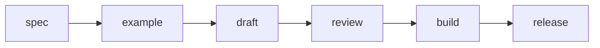

# 第 7 章 全流程編排實戰：用多 Agent 自動化產出科技書

> 多 Agent 出版流水線把規格、範例、正文、審稿與建置串成可重跑流程。本章實作出版任務圖與品質閘門。

---

## 7.1 本章導讀：把分工變成流水線

前面幾章分別介紹了 Herdr 的監管、Pi 的微修、OpenCode 的 Plan / Build、Hermes 的反思審稿，以及 Codex 的測試沙盒。這些能力若各自存在，只是一組好工具；真正產生價值的，是把它們串成可重跑的出版流水線。

科技書生產不是單一步驟。使用者提出主題後，需要先形成 PRD，再拆章節規格，接著開發可執行範例，然後撰寫正文，之後審稿、校對、排版、建置、打包與發布。每個階段都有輸入、輸出、負責 Agent 與品質閘門。若沒有編排，整個流程就會依賴人類記憶；若有清楚 pipeline，代理團隊就能穩定交付。

本章以 `examples/ch07_book_pipeline/` 的任務圖為例，說明如何定義出版階段、階段依賴與品質閘門。重點不是做出龐大的 workflow engine，而是理解一個原則：任何可重複的出版工作，都應該被建模為明確階段與可驗證條件。



## 7.2 出版 pipeline 的基本階段

本書採用的核心流程可以拆成八個階段。

第一是需求與 PRD。這一階段決定書名、讀者、章節範圍、技術深度、出版格式與成功標準。若 PRD 不清楚，後面所有章節都會漂移。

第二是章節規格。每章要有學習目標、核心概念、範例方向、驗收標準與風險說明。Hermes 適合維護這一層，因為它關注全書一致性。

第三是程式範例。Codex 根據規格建立 examples，寫測試並確保可執行。正文應引用已驗證的範例，而不是先寫概念再希望程式能補上。

第四是正文草稿。OpenCode 根據規格與範例撰寫章節，把程式、概念與情境整合成讀者能理解的教學內容。

第五是審稿。Hermes 檢查技術正確性、跨章一致性與教學完整度，產出 QA 報告。

第六是微修與格式。Pi 修正標點、Markdown 結構、Typst 相容性與小型文字問題。

第七是建置。Antigravity 或 build script 將 Markdown 轉成 Typst，產出 cover 與 interior PDF。

第八是發布。產生 manifest、checksum、release note 與上架素材，準備交付讀者或平台。

## 7.3 階段輸入、輸出與負責 Agent

每個階段都應有明確輸入與輸出。沒有輸入，代理會亂猜；沒有輸出，下一階段無法驗收。

PRD 階段的輸入是使用者需求，輸出是 `docs/prd.md`。章節規格階段的輸入是 PRD，輸出是 `docs/chapter_specs/chXX_spec.md`。範例階段的輸入是章節規格，輸出是 `examples/chXX_*/` 以及測試結果。正文階段的輸入是規格與範例，輸出是 `src/chXX.md`。審稿階段的輸入是正文與測試結果，輸出是 `qa/reports/chXX_review_report.md`。建置階段的輸入是所有正文與模板，輸出是 `dist/cover.pdf` 與 `dist/book_interior.pdf`。

這種設計有助於代理交接。OpenCode 不必猜測範例在哪裡；Codex 不必理解整本書所有排版；Pi 不必重新審查技術架構；Hermes 不必執行所有命令。每個 Agent 都在明確邊界中貢獻。

| 階段 | 輸入 | 輸出 | 負責 Agent | 驗收 |
|---|---|---|---|---|
| spec | 使用者需求 / PRD | `docs/chapter_specs/` | Hermes | 規格完整、目標清楚 |
| example | 章節規格 | `examples/chXX_*/` | Codex | pytest 通過 |
| draft | 規格 + 範例 | `src/chXX.md` | OpenCode | 章節完成、引用正確 |
| review | 正文 + 測試結果 | `qa/reports/` | Hermes | QA 通過、無重大錯誤 |
| build | `src/` + `templates/` | `dist/*.pdf` | Pi / Antigravity | Typst build 通過 |
| release | PDF + docs + QA | manifest + zip | Antigravity | checksum 完整、人工核准 |

這張表是全書生產流程的總覽。當任務卡住時，先判斷它屬於哪個階段，再回到該階段的輸入、輸出與負責 Agent，而不是讓所有代理同時介入。

## 7.4 實戰範例：pipeline.py

本章範例位於：

```text
examples/ch07_book_pipeline/
```

核心程式碼如下：

```python title="examples/ch07_book_pipeline/pipeline.py"
from __future__ import annotations
from dataclasses import dataclass
from typing import Dict, List

@dataclass(frozen=True)
class Stage:
    name: str
    requires: List[str]

def default_stages() -> List[Stage]:
    return [
        Stage("spec", []),
        Stage("example", ["spec"]),
        Stage("draft", ["example"]),
        Stage("review", ["draft"]),
        Stage("build", ["review"]),
        Stage("release", ["build"]),
    ]

def ready_stages(done: List[str], stages: List[Stage]) -> List[str]:
    completed = set(done)
    return [s.name for s in stages if s.name not in completed and set(s.requires) <= completed]

def quality_gate(results: Dict[str, bool]) -> bool:
    return all(results.get(key, False) for key in ["tests", "review", "build"])
```

`Stage` 定義了階段名稱與依賴。`default_stages` 建立一條簡化出版流程：先規格、再範例、再草稿、再審稿、再建置，最後進入 release。`ready_stages` 根據已完成階段計算下一步可執行項目。這讓 pipeline 不必靠硬編碼順序，而能根據依賴判斷。

`quality_gate` 則是發布前的最低檢查：測試、審稿與 build 都必須通過。真實出版流程可以加入更多條件，例如封面存在、字數達標、checksum 產生、release note 完成、人工最終核准。

## 7.5 品質閘門：不要把半成品推到下一階段

品質閘門是 pipeline 的核心。沒有品質閘門，流程只會變成自動搬運半成品。

規格階段的閘門可以是：章節目標明確、範例方向明確、驗收方式明確。範例階段的閘門是測試通過。正文階段的閘門是引用路徑存在、內容達到字數與結構要求。審稿階段的閘門是無重大錯誤。建置階段的閘門是 PDF 成功產出。發布階段的閘門是 artifacts、manifest 與 checksum 完整。

品質閘門也能防止代理互相放大錯誤。如果 Codex 的範例沒有通過測試，OpenCode 不應引用它寫教學；如果 Hermes 指出章節技術錯誤，Pi 不應只修標點就進入 build；如果 build 失敗，release 不應繼續打包。

## 7.6 衝突處理與交接格式

多 Agent 協作一定會遇到衝突。常見衝突包括：規格要求 A，但範例實作成 B；正文引用舊函式名稱；審稿要求重寫，但 build 已經進入排版；Pi 修格式時發現原文邏輯不通。

處理衝突的原則是回到任務合約。誰擁有該檔案？哪個階段是權威來源？目前品質閘門是否通過？例如程式行為以 examples 測試為準，章節意圖以 chapter_specs 為準，出版產物以 build 結果為準。

交接摘要應包含五項：目前階段、已完成產物、待處理問題、驗證結果、下一步建議。這樣下一個 Agent 不必讀完整歷史，也能安全接手。

## 7.7 本專案目錄結構解析

本書專案的目錄本身就是 pipeline 的落地形式。

`docs/` 保存 PRD 與章節規格，代表需求與設計層。`examples/` 保存可執行範例，代表工程驗證層。`src/` 保存正文，代表教學內容層。`qa/reports/` 保存審稿報告，代表品質記錄層。`templates/` 保存 Typst 樣式，代表排版層。`scripts/` 保存測試與建置腳本，代表自動化層。`dist/` 保存產物，代表發布輸出層。

這種結構讓代理分工自然落地。Codex 修改 examples，OpenCode 修改 src，Hermes 修改 docs 與 qa，Pi 修正文與模板的小型問題，Antigravity 編排 scripts 與 dist。清楚的目錄責任制可以降低互相覆蓋的風險。

## 7.8 驗證策略

執行測試：

```bash
cd examples/ch07_book_pipeline
PYTHONPATH=. python3 -m pytest -v
```

測試應確認：在沒有完成任何階段時，只有 `spec` ready；完成 `spec` 後，`example` ready；品質閘門必須在 tests、review、build 都為真時才通過。

全書層級還應執行：

```bash
bash scripts/test_all.sh
python3 scripts/build.py
```

這代表 pipeline 不只在單章概念上成立，也能支撐整本書產物。

## 7.9 實戰練習

1. 在 `default_stages` 中加入 `package` 階段，放在 `build` 與 `release` 之間。
2. 為 `quality_gate` 增加 `checksum` 與 `release_note` 條件。
3. 設計一份 handoff 模板，讓每個 Agent 交接時填寫。
4. 為本書新增一個 `status.md`，記錄各章目前階段。
5. 思考若兩個 Agent 同時想修改同一章，應由誰決定合併順序。

## 7.10 版本控管與 Release Candidate

當 pipeline 能穩定產出 PDF 後，下一個問題是版本控管。書籍和軟體一樣需要版本。草稿階段可以使用 `0.x`，首次可公開版本可以標為 `1.0.0`，小幅修正可以增加 patch 版本，大幅新增章節則增加 minor 版本。

Release Candidate，簡稱 RC，是正式發布前的候選版本。RC 的意義是：內容、範例、測試與排版都已完成，但仍保留最後審查時間。多 Agent 團隊可以為 RC 設計額外檢查，例如全書字數達標、所有 QA 報告為 PASS、PDF 頁面無明顯排版錯誤、release manifest 完整。

版本控管也能幫助讀者。若讀者回報第 6 章範例有問題，維護者可以詢問版本號與 checksum，確認問題發生在哪次發布。沒有版本資訊的書籍，很難進行可靠支援。

## 7.11 Pipeline 的漸進式自動化

出版 pipeline 不必一開始就完全自動化。建議採用漸進式策略。第一階段先自動化測試與 build；第二階段加入字數統計、路徑檢查與 QA 報告彙整；第三階段加入 package 與 manifest；第四階段才考慮自動上傳或上架。

漸進式自動化的好處是容易定位風險。若一開始就把所有步驟綁在一起，失敗時很難判斷是範例問題、正文問題、排版問題還是發布問題。每增加一層自動化，都應先確保前一層穩定。

這也符合多 Agent 協作精神：先建立可觀測狀態，再建立可驗證交付，最後才增加自動決策。自動化不是越多越好，而是每一步都要能被解釋、被測試、被停止。

## 7.12 度量指標：如何知道書越來越完整

Pipeline 還應提供度量指標。對書籍來說，常見指標包括：各章字數、範例測試通過率、QA 報告狀態、build 成功率、PDF 產物大小、未解決 TODO 數量、章節規格覆蓋率。

這些指標讓團隊不必憑感覺判斷進度。例如目前若第 2 章有 4000 字、第 3 到第 8 章約 3000 字，就能知道第一輪擴充接近完成；若所有 tests 通過但 QA 報告尚未更新，就知道下一步是審稿而不是繼續寫程式。

## 7.13 出版流水線檢查清單

一次完整出版任務應確認：PRD 已存在、章節規格已存在、examples 測試通過、正文已達最低篇幅、QA 報告已建立、Typst build 成功、dist 產物存在、release manifest 可產生。這些條件不必全靠人類記憶，可以寫入 pipeline 或狀態報告。

若其中某項未完成，pipeline 應回到對應階段，而不是繼續向前。例如測試未通過就回到 Codex，正文不足就回到 OpenCode，審稿問題就回到 Hermes，排版錯誤就交給 Pi 或 build 維護者。流程能回退，才是真正可用的流程。

## 7.14 你現在應該能做到

讀完本章後，你應該能：

- 用 Stage 與依賴關係描述出版 pipeline。
- 判斷每個階段的輸入、輸出、負責 Agent 與驗收條件。
- 使用 quality gate 決定是否能進入發布階段。
- 設計一份簡單的專案狀態表與 release candidate 流程。

## 7.15 本章小結

本章把多 Agent 工具串成完整出版 pipeline。規格、範例、正文、審稿、建置與發布不再是零散動作，而是有依賴、有責任、有品質閘門的流程。

下一章將進入最後一哩路：Typst 排版、封面、release manifest、checksum 與 CI/CD。當內容與測試都準備好後，我們還需要把書變成可交付的出版品。
